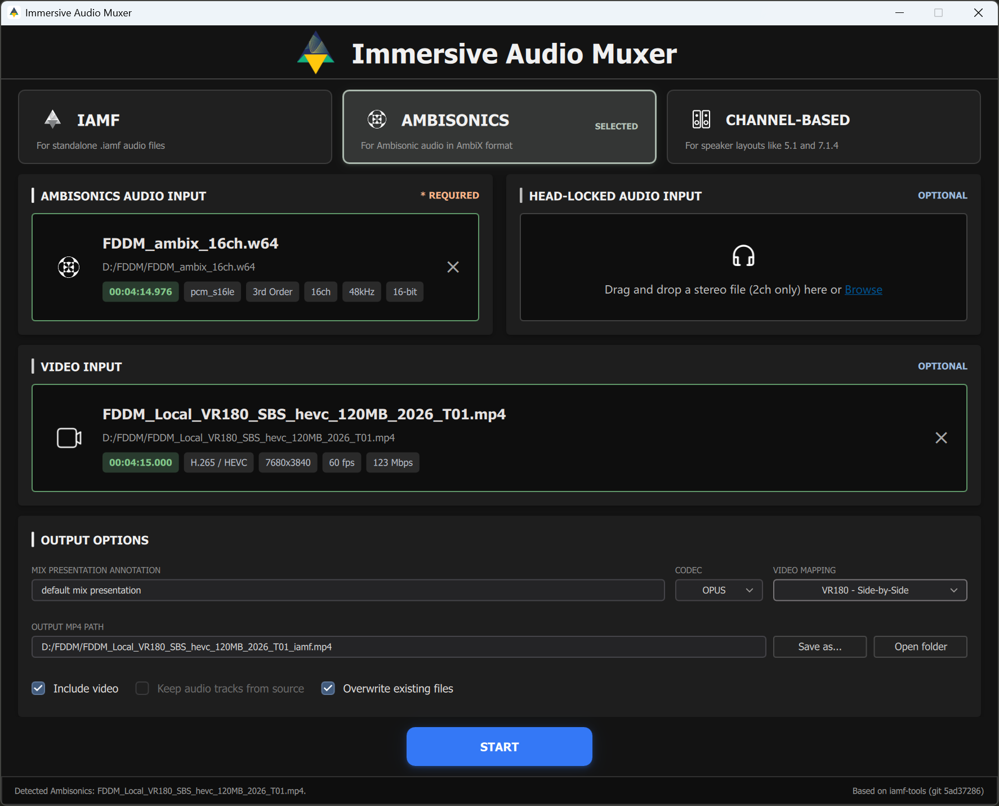

# Immersive Audio Muxer

A simple desktop GUI for converting existing spatial audio to the IAMF format and muxing it into MP4, with optional video—all in a few clicks.

IAMF stands for [**Immersive Audio Model and Formats**](https://aomedia.org/specifications/iamf/), an open-source, royalty-free spatial audio standard developed by the Alliance for Open Media (AOMedia).

<p align="center">
  
</p>

## Features

- **Standalone IAMF** — mux an existing `.iamf` file into an MP4 container.
- **Ambisonics** — create IAMF from AmbiX audio with 4, 9, or 16 channels. An optional two-channel Head-Locked Stereo input can be added in this mode.
- **Channel-based audio** — create IAMF from mono, stereo, 3.1.2, 5.1, 5.1.2, 5.1.4, 7.1, 7.1.2, 7.1.4, or 9.1.6 audio.
- **YouTube metadata** — choose a video mapping and inject YouTube-compatible spatial video metadata into the MP4.
- **Multiple audio tracks** — optionally retain the MP4's original audio tracks alongside IAMF, allowing standard audio and one or more IAMF tracks to coexist in the same file.
- **Encoding choices** — generated IAMF audio can use Opus, LPCM, AAC-LC, or FLAC. An existing IAMF input keeps its encoded audio.

## Quick start

1. Choose **IAMF**, **Ambisonics**, or **Channel-Based** mode.
2. Add the required audio input. For multichannel Channel-Based audio, choose the input order that matches the source file. Add Head-Locked Stereo or video when needed.
3. Set the output path and available encoding or video options.
4. Select **Start** to create the MP4 file.

## Downloads

Currently, prebuilt packages are provided for Windows x64 and macOS arm64. Downloadable assets will appear on the project's release page after a release is published successfully.

## Build from source

The GUI build requires:

- CMake 3.22 or newer and a C++17 compiler.
- Qt 6.8 or newer, including Core, Gui, Multimedia, QML, Quick, Quick Controls 2, Quick Dialogs 2, and SVG.
- An FFmpeg development prefix with `avformat`, `avcodec`, `avutil`, and `swresample` headers and libraries.
- Git and network access during the initial configure and build, so CMake can fetch the pinned `iamf-tools` encoder and `spdlog` dependencies.

On Linux and macOS, the repository includes a helper to build the project's pinned FFmpeg configuration and apply its maintained patch:

```bash
bash scripts/build_ffmpeg.sh \
  --source-dir ../ffmpeg-src \
  --prefix ../ffmpeg-prefix
```

On Windows, provide an FFmpeg development prefix built for the same compiler and architecture as the application. After setting up Qt and FFmpeg, configure and build the GUI with CMake (replace the placeholder paths for your environment):

```bash
cmake -S . -B build \
  -DCMAKE_BUILD_TYPE=Release \
  -DCMAKE_PREFIX_PATH=/path/to/Qt \
  -DIMMERSIVE_AUDIO_MUXER_FFMPEG_PREFIX=/path/to/ffmpeg-prefix \
  -DIMMERSIVE_AUDIO_MUXER_BUILD_GUI=ON
cmake --build build --config Release
```

The test targets are enabled by default. After building, run them with:

```bash
ctest --test-dir build -C Release --output-on-failure
```

The `scripts/package_windows.ps1` and `scripts/package_macos.sh` scripts provide platform packaging entry points.

## How it works

FFmpeg handles media probing, audio preparation, and video and source-audio stream handling. For Ambisonics and channel-based workflows, the application uses the official `iamf-tools` encoder in process to generate IAMF audio. The muxer writes the IAMF MP4 track structure and interleaves media samples. Standalone IAMF input is packaged without decoding and re-encoding its audio.

This is a muxing and encoding tool, not an IAMF player. Playback depends on the software used to open the resulting MP4.

## Dependencies

- [FFmpeg](https://ffmpeg.org/)
- [iamf-tools](https://github.com/AOMediaCodec/iamf-tools)
- [Qt](https://www.qt.io/)
- [spdlog](https://github.com/gabime/spdlog)

Third-party components retain their own licenses. Refer to their license files and to the notices included with release packages.

## License

The project is distributed under the [MIT License](LICENSE). This license applies to the project's own code; third-party components remain under their respective licenses.
